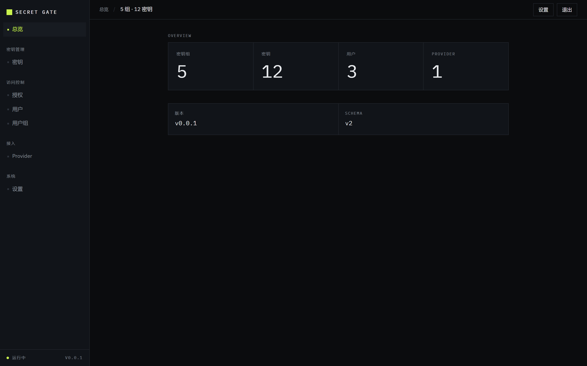
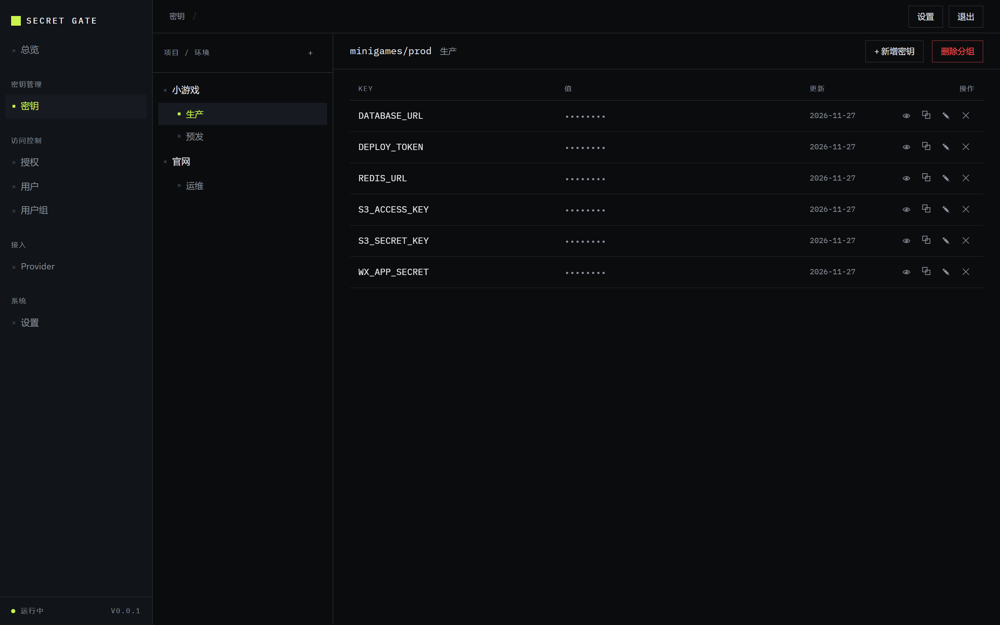
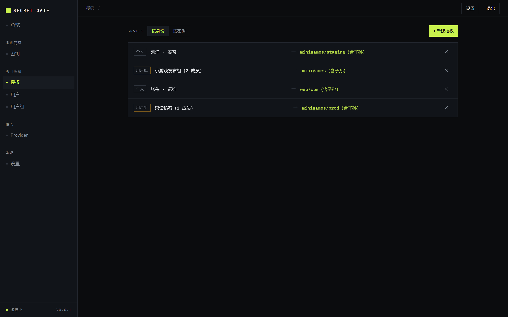
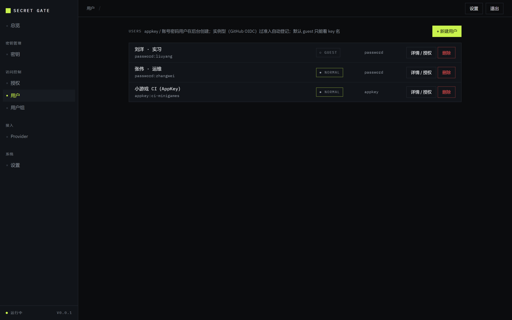
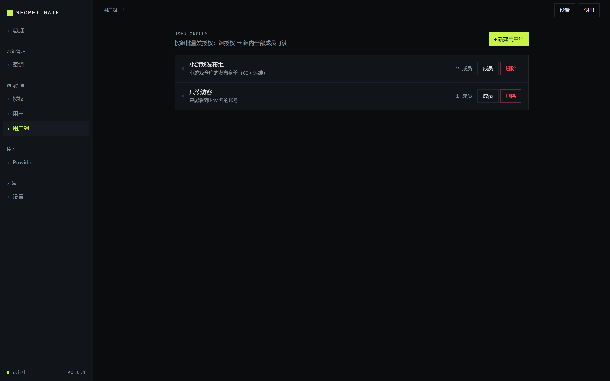
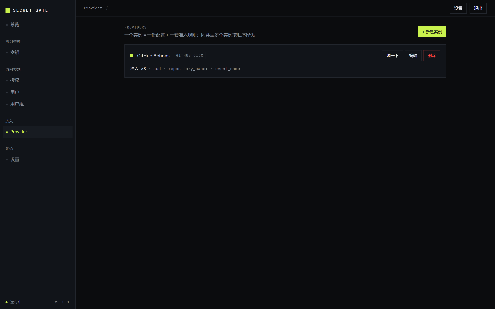
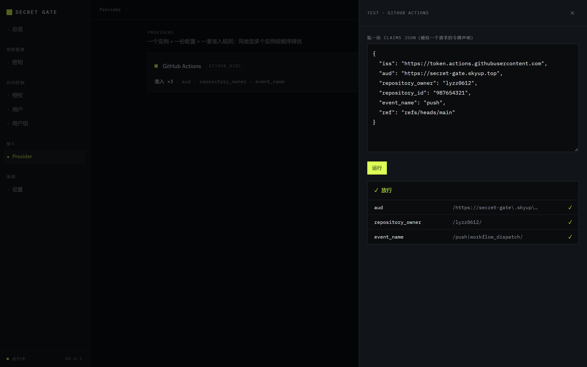
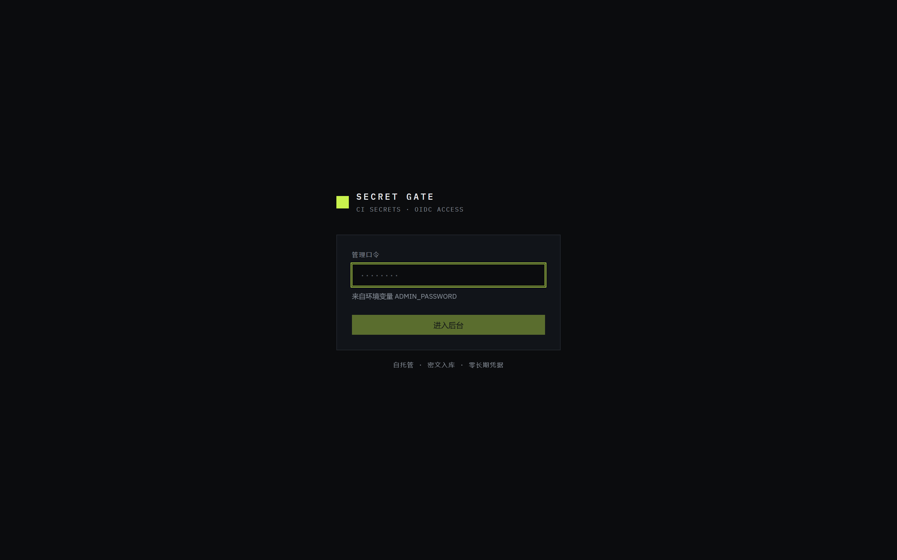
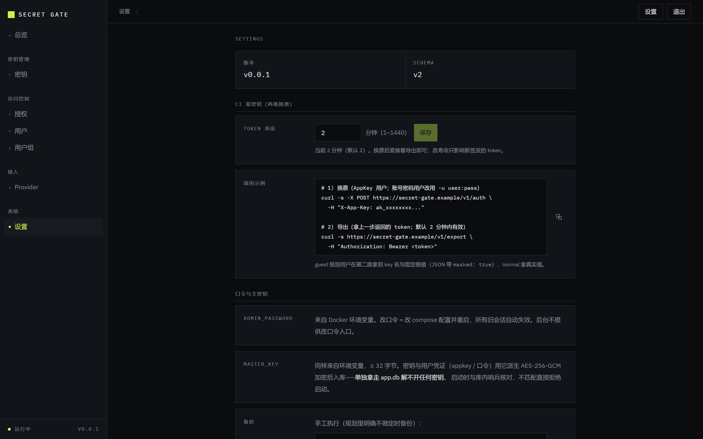

# Secret Gate

自托管的轻量密钥服务：**GitHub Actions / GitLab CI / Vercel** 用各自签发的一次性 OIDC 令牌取走被授权的密钥，脚本和其他 CI 用 AppKey 或账号密码——**仓库里不再存任何长期凭据**。Infisical 的个人版：砍掉多租户 / RBAC / 审批流，保留 OIDC 短令牌、两跳换票、加密入库、按身份授权。

## 它解决什么

- 密钥散在各个仓库的 `secrets.*` 里，轮换要挨个仓库点 → 集中一处，改一次全员生效
- workflow 里的长期 PAT / CI key 泄了只能手工吊销 → OIDC 令牌几分钟自灭，且只绑指定项目 / 分支 / 事件
- 每个平台各搞一套取密钥的方式 → 一个服务、三类令牌，按实例名区分、按准入规则放行
- 担心数据库文件被拿走 → 密钥 AES-256-GCM 加密后入库，密钥在环境变量里

## 支持的调用方

| 调用方 | 带什么令牌 | 身份键（一个身份一个用户） | 建议准入规则 |
|---|---|---|---|
| GitHub Actions | ID token（`permissions: id-token: write`） | `repository_id` | `repository_owner`、`event_name`、`ref` |
| GitLab CI | ID token（`.gitlab-ci.yml` 的 `id_tokens:`） | `<issuer host>#<project_id>` | `project_id`、`ref_protected`、`pipeline_source` |
| Vercel | `VERCEL_OIDC_TOKEN`（构建 / Function 里自动有） | `project_id` | `project_id`、`environment` |
| 脚本 / 其他 CI | AppKey 或 账号:口令 | 后台建的用户行 | —（凭证本身就是身份） |

两类插件：**实例型**是上面三个 OIDC 平台（后台可建多个实例，各带 issuer 与规则）；**内置型**是 AppKey / 账号密码（凭证挂在用户行上，后台「用户」页建，不建实例）。

## 界面

后台共七个页面：总览 / 密钥 / 授权 / 用户 / 用户组 / Provider / 设置。下面截图取自本地开发实例（`scripts\dev.bat` 起的服务，库里是演示数据）；界面仍在演进，新增能力以文字说明与 [docs/impl-log.md](docs/impl-log.md) 为准。





| 授权 | 用户 |
| :--: | :--: |
|  |  |
| **用户组** | **Provider 实例** |
|  |  |

准入规则的「试一下」：贴一份 claims，逐条看命中 / 缺失：



<details>
<summary>登录页 / 设置页</summary>

| 登录 | 设置 |
| :--: | :--: |
|  |  |

</details>

## 快速开始（Docker）

```yaml
services:
  secret-gate:
    image: ghcr.io/lyzz0612/secret-gate:latest
    restart: unless-stopped
    ports: ["127.0.0.1:8788:8788"]
    environment:
      MASTER_KEY: "<必改：openssl rand -hex 32>"
      ADMIN_PASSWORD: "<必改：后台口令>"
    volumes:
      - ./data:/app/data
    healthcheck:
      test: ["CMD", "/vaultd", "-healthcheck"]
      interval: 30s
      timeout: 3s
      retries: 3
```

详细部署（1Panel 反代 / ghcr 私有镜像处理 / 首次接入闭环）：[docs/deploy.md](docs/deploy.md)。

## 本地运行

不装 Docker，本机直接跑（Go 1.27+、Node 20+）：

```
scripts\dev.bat
```

脚本依次做四件事：检查 go / node → 首次 `npm --prefix web install` → 构建前端（产物 `go:embed` 进二进制）→ 用固定的开发密钥起服务并打开浏览器。地址 <http://127.0.0.1:8788/admin>，口令 `dev`；`MASTER_KEY` / `ADMIN_PASSWORD` 可用环境变量覆盖，`SG_NO_BROWSER=1` 跳过自动开浏览器。

数据落在 `data/app.db`（单文件 SQLite）；想从零重来：停服务 → 删 `data/app.db` → 重跑 `dev.bat`。

## 接入第一个项目

后台「接入」页建一个实例：**实例名就是接入标识，也是唯一的区分维度**——CI 侧用它指名实例（`POST /v1/auth/{实例名}`），服务端按名字取该实例的 issuer 验签、只跑这条实例的规则。GitHub Actions 无配置项；GitLab / Vercel 填 `issuer`（GitLab 实例地址 / Vercel 的 `https://oidc.vercel.com/<team>`）。准入规则建议：`repository_owner`（GitHub）或 `project_id`（GitLab / Vercel），GitLab 上再加 `ref_protected=true` 与 `pipeline_source` 白名单。

`aud`（audience）不是门槛，不用配规则：三个平台都要求调用方在要令牌时给一个 audience 值，但 secret-gate 只认实例，不校验它。

```yaml
jobs:
  deploy:
    runs-on: ubuntu-latest
    permissions:
      id-token: write        # 只需要这一条
      contents: read
    steps:
      - uses: actions/checkout@v4
      - name: 载入密钥
        run: |
          # audience 是平台要求的参数，值随你填（secret-gate 不校验它）
          TOKEN=$(curl -sS -H "Authorization: bearer $ACTIONS_ID_TOKEN_REQUEST_TOKEN" \
            "$ACTIONS_ID_TOKEN_REQUEST_URL&audience=https://secrets.example.com" | jq -r .value)
          # 第一跳：OIDC 令牌换短期 token（默认 2 分钟寿命）；github-me 是实例名
          V1=$(curl -sS -X POST -H "Authorization: Bearer $TOKEN" \
            https://secrets.example.com/v1/auth/github-me | jq -r .token)
          # 第二跳：拿短期 token 导出
          curl -sfS -H "Authorization: Bearer $V1" \
            "https://secrets.example.com/v1/export?group=minigames/prod&format=env" \
            | while IFS= read -r line; do
                echo "::add-mask::${line#*=}"
                echo "$line" >> "$GITHUB_ENV"
              done
```

首次运行会在后台「用户」页自动登记该仓库身份（按实例配置的默认分级，默认 guest）——授个权、需要真值就提级 normal，再跑一次即拿到密钥；实例上还能配「新身份自动进哪些用户组」，接管后就不用手工点第二遍。

**GitLab CI / Vercel** 走同一个第一跳，只是令牌来源不同：

```yaml
# .gitlab-ci.yml：aud 是 GitLab 要求的字段，值随你填（服务端不校验）
deploy:
  id_tokens:
    SG_TOKEN:
      aud: https://secrets.example.com
  script:
    - V1=$(curl -fsS -X POST -H "Authorization: Bearer $SG_TOKEN" \
        https://secrets.example.com/v1/auth/gitlab-m68 | jq -r .token)
```

```ts
// Vercel 构建或 Function 里（VERCEL_OIDC_TOKEN 自带 aud，无需关心）
const v1 = await fetch('https://secrets.example.com/v1/auth/vercel-acme', {
  method: 'POST',
  headers: { Authorization: `Bearer ${process.env.VERCEL_OIDC_TOKEN}` },
}).then((r) => r.json())
```

GitLab 的 `project_id` 才是稳定身份键（`sub` 可被项目改配置，别拿它当键）；Vercel 用 `project_id` + `environment` 卡环境。

**本仓库自带「Secret Gate 自测」workflow**（Actions 页手动触发，地址写死 `https://secret-gate.skyup.top`）：打 healthz、取真 OIDC 令牌、走两跳换票、调 `/v1/export`，失败信息会指明是部署、验签、准入、授权还是分级的问题。非 OIDC 调用方在「用户」页建 **AppKey / 账号密码** 用户（`X-App-Key` 头或 Basic auth 走同一个 `/v1/auth`），凭证加密入库、随时可查看与轮换。

## 概念（两跳 + 分级）

```
第一跳 POST /v1/auth 或 /v1/auth/{实例名}（凭证只在这里出现）
   X-App-Key: ak_… ──┐
   Basic 账号:口令 ────┼→ 插件认证(验签 401) → 内置型查用户行 / 实例准入(正则 AND, 403)
   Bearer OIDC 令牌 ──┘   → 首次登记(默认分级 + 自动入组) → 签发短期 token(默认 2 分钟, 设置页可调)
                              ↓ {"token", "expires_in", "role"}
第二跳 GET /v1/export（只认短期 token）
   授权(个人 ∪ 用户组 → 密钥组[含子孙] / 单条) 实时展开
   → normal 解密真值 / guest 只给 key 名 + 固定假值(响应带 masked:true)
```

- **插件类型**（代码）分两种：实例型三个 OIDC 平台（`github_oidc` / `gitlab_oidc` / `vercel_oidc`）后台可建多个实例，issuer 由插件声明（GitHub 写死常量，GitLab / Vercel 由实例配置）；**内置型**（appkey / 账号密码）凭证直接挂在用户行上，后台「用户」页创建、不建实例。加新类型 = 一个 Go 包 + 一行注册
- **实例名 = 接入标识**：`POST /v1/auth/{实例名}` 指名只用那一条实例（不问不猜）；不带名字则按类型与准入规则择优（存量 GitHub 调用方式不变）。名字要能进 URL，只能是字母数字 `.` `_` `-`，全局唯一，改名等于换标识
- **自动登记一次落地**：实例配的默认分级（guest / normal）与「自动加入的用户组」只在身份首次登记时写一次——之后以后台为准，管理员降级或移出组不会被下一次请求静默改回去
- **用户分级**：`guest` 只能看到 key 名（导出值为 `fake_value`），`normal` 拿真实值；未配置时默认 guest，去用户页提级
- **JSON 导出是数组**：`[{"group", "key", "value"}]` 按 `group/key` 字典序——同名 key 跨组共存（每分组各一条）；env 格式是扁平 namespace 装不下同名，冲突时 422 点名分组，用 `?group=` 精确过滤消解
- **密钥组**两级：`项目/环境`；授权给父组 = 含全部子孙
- **过准入规则即自动登记**（实例型），没有待批准：规则就是门槛（如 owner 限定），进来了能读什么由授权决定，没授权 = 空集
- **授权每次请求实时计算**：删授权 / 切分级立即生效
- **所有删除都是真删**，无归档无回收站
- 准入规则 = 字段正则：整串锚定、规则间 AND、字段缺失不匹配、保存时编译校验；后台有「试一下」

## 安全边界

- 密钥与用户凭证（appkey / 口令）AES-256-GCM 加密入库，AAD 每行随机 salt——单独拿走 `app.db` 解不开任何东西；`MASTER_KEY` 换错服务拒绝启动（哨兵自检）
- 明文只出现在：内存、reveal 接口（点眼睛时）、`/v1/export`（通过认证+准入+授权+normal 后）；API 响应 `Cache-Control: no-store`
- appkey 认证按 sha256 索引命中（拿走 db 也推不出凭证）；口令比对常量时间；`/v1/auth` 与后台登录共用限流
- 后台单口令（环境变量），改口令 = 改配置重启，旧会话全失效；登录限流每 IP 10 次/分
- **不防**：主机被 root、进程内存被 dump、同时拿到 db 和环境变量的人
- 备份 `app.db` 必须与当时的 `MASTER_KEY` 配套，分开存

## 扩展：加一个新平台

一个平台 = 一个 Go 包 + 一行注册，前端零改动（表单与规则字段都由插件声明）：

1. 在 `internal/app/plugins/<name>/` 实现 `plugins.PluginType`：`Type` / `Label` / `Builtin` / `Match` / `ConfigFields`（后台表单长什么样）/ `ClaimFields`（规则可选哪些字段）/ `Parse`（验签 + 取身份键）/ `Accept` / `FindUser`
2. `cmd/vaultd/main.go` 加一行 `registry.Register(<name>.New())`
3. 后台「接入」页新建实例即出现该类型

OIDC 类插件不用重写验签：直接复用 `internal/infra/oidc`（`discovery` 定位 JWKS + 缓存 + RS256 + 时间窗），只需给出 issuer 从哪来（代码常量还是实例配置）和身份键取哪个 claim。现有的 `github_oidc` / `gitlab_oidc` / `vercel_oidc` 都是这么实现的，各自约 100–150 行。

## 开发

```
go test ./...                    # 后端：5 包 64 个测试函数
npm --prefix web run build       # 前端：产物 go:embed 进二进制（约 18 MB）
```

技术栈：Go 标准库（`net/http` 路由、AES-GCM、RS256 验签手写）+ 2 个第三方依赖（纯 Go SQLite、x/crypto）；前端 Vite + React 19 + Tailwind 4 + Radix。

Go module 名仍是 `github.com/lyzz0612/deploy-center`（仓库已改名 `secret-gate`，模块名还没动）。

**发版**：push 到 `master` → CI 跑测试 → git tag 末位 +1（v0.0.x）→ 构建镜像推 ghcr。`**.md` 与 `docs/**` 不触发。

进度与设计：[docs/plan.md](docs/plan.md) · 实施日志：[docs/impl-log.md](docs/impl-log.md)
